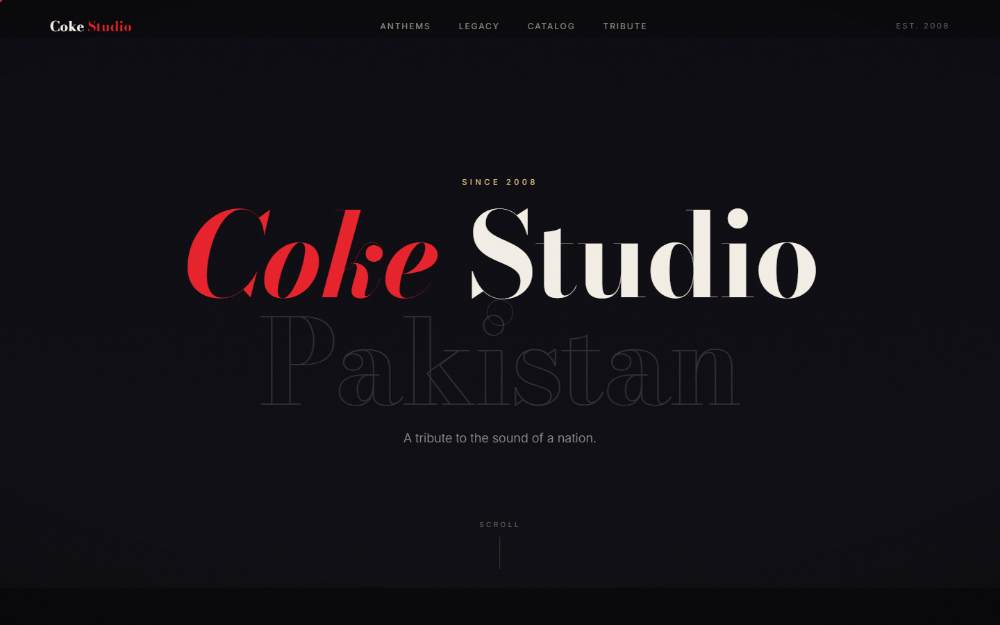
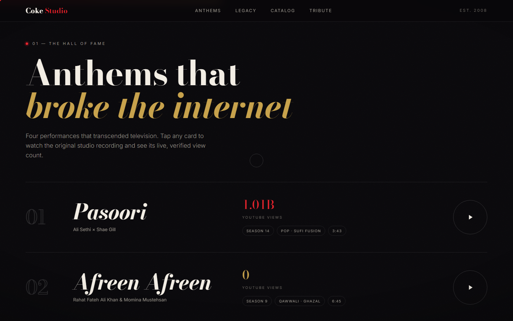
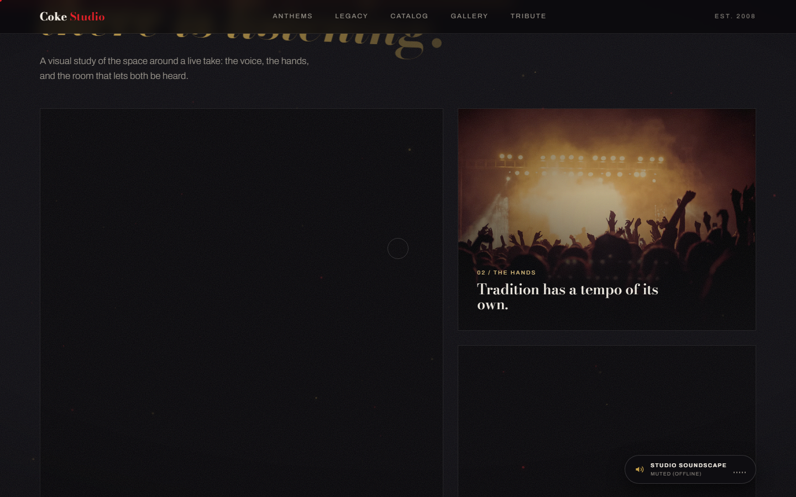
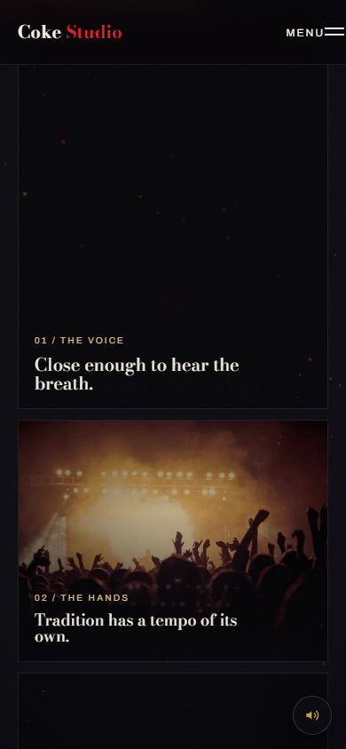

# Coke Studio Pakistan: A Tribute

<p align="center">
	
</p>

<p align="center">
	<strong>A cinematic, independent tribute to the sound of Pakistan since 2008.</strong><br />
	Scroll through the film, revisit the anthems, and explore the room around the music.
</p>

<p align="center">
	<a href="#run-locally">Run locally</a> ·
	<a href="#what-is-inside">What is inside</a> ·
	<a href="#controls">Controls</a> ·
	<a href="#credits-and-sources">Credits</a>
</p>


> This project is an independent, non-commercial tribute. It is not affiliated
> with Coca-Cola or Coke Studio Pakistan. View counts are dated public snapshots
> and video links point to authentic studio recordings.

## The experience

This is not a template landing page. It is structured like a short film and an
archive:

- **Scroll-scrubbed opening film:** a procedural canvas scene that changes as the page moves.
- **Hall of Fame:** four landmark performances with real YouTube playback, view counts, genres, and artists.
- **Legacy timeline:** producer eras presented as a pinned horizontal journey.
- **The Room:** a human-centered image chapter around voice, hands, and the recording space.
- **Living catalog:** era filters plus title, artist, season, and genre search.
- **Visual archive:** instrument and studio studies with keyboard-accessible lightbox viewing.
- **Studio soundscape:** an optional browser-generated drone with no audio file download.
- **Responsive by design:** labelled mobile navigation, touch-safe controls, reduced-motion support, and focus-managed dialogs.

## Preview

The animated masthead above is a lightweight SVG included in the repository. The
screenshots below are captured from the running site at real viewport sizes.

<p align="center">
	
	
</p>
<p align="center">
	
	
</p>

## Run locally

Requirements: Node.js 18 or newer. There is no build step and no framework.

```bash
npm install
npm start
```

Open [http://localhost:5173](http://localhost:5173).

The server is intentionally small and dependency-free. You can also use any
static server that serves the project root, but a local server is recommended so
fonts, YouTube embeds, lazy images, and the browser audio context behave normally.

## Controls

| Input   | Action                                                                        |
| ------- | ----------------------------------------------------------------------------- |
| Scroll  | Play the opening film and move through the archive                            |
| `Space` | Open the first Hall of Fame anthem                                            |
| `M`     | Toggle the studio soundscape                                                  |
| `A`     | Jump to Anthems                                                               |
| `G`     | Jump to the visual Gallery                                                    |
| `?`     | Open the studio keyboard help                                                 |
| `Esc`   | Close an open menu, modal, or lightbox                                        |
| Touch   | Use the labelled menu, filter controls, search, and tap-to-open archive items |

## What is inside

```text
.
├── index.html
├── assets/
│   ├── css/styles.css       # tokens, layout, typography, responsive states
│   ├── img/                 # local artwork and studio imagery
│   ├── readme-motion.svg    # animated GitHub README masthead
│   └── js/
│       ├── data.js          # stats, anthems, eras, and catalog source data
│       └── app.js           # film engine, rendering, modals, filters, audio
├── anti-slop/               # design audit and delivery-gate records
├── test/                    # Playwright smoke, visual, and interaction checks
├── server.js                # zero-dependency local preview server
├── package.json
└── README.md
```

## Design decisions

The visual language is documented in [DESIGN.md](DESIGN.md): Bodoni Moda for the
film-poster voice, Archivo for quiet interface text, a warm near-black stage, Coke
red, lamp-light gold, and slow motion with a purpose.

The canvas film is procedural rather than a downloaded video. Its frame is a pure
function of scroll progress, which keeps the effect crisp at any viewport and
allows the visitor to reverse it naturally. When animation CDNs are unavailable,
the page falls back to plain scrolling while preserving its content and core
interactions.

## Accessibility and resilience

- Skip link and visible keyboard focus states.
- Full-screen labelled mobile menu with 44px touch targets.
- Focus trap and focus restoration for video and image dialogs.
- Reduced-motion behavior for animation-heavy sections.
- No horizontal overflow at the tested mobile viewport.
- Loading and fallback states for YouTube playback.
- Core content still renders when GSAP and Lenis CDNs are blocked.

## Verification

Start the server in one terminal, then run:

```bash
node test/smoke.js
node test/verify_masterpiece.js
```

The smoke suite checks injected content, the canvas, scroll chapters, modal
playback, and application errors. The interaction suite checks the soundscape,
catalog filters, gallery lightbox, keyboard shortcuts, and screenshot capture.

## Credits and sources

This tribute site was made by **Ahmed Ali Ghori**.

- Seasons, episodes, and producer eras: Wikipedia and official Coke Studio media references.
- View and subscriber snapshots: YouTube public analytics and socialcounts.org, October 2026.
- Performance links: official Coke Studio Pakistan YouTube uploads and search results.
- Room-study imagery: public/licensed Unsplash imagery, labelled as interpretive atmosphere studies.

## License

The source code is marked MIT in `package.json`.
Brand names, trademarks, music, recordings, and third-party artwork remain the
property of their respective owners. This repository is an independent tribute,
not an official Coke Studio Pakistan project.
